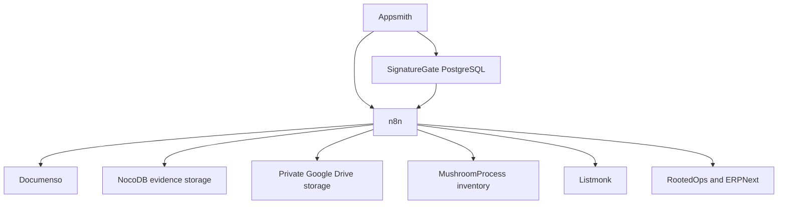

# Architecture and interoperability

## Identities, capacities and permissions

SignatureGate stores individuals in `people` and companies/business entities in `organizations`. Participant and Contributor are capacities held by an identity; they are not identities themselves. Only an individual may hold Participant capacity. A Contributor may be an individual or a company.

For Rooted Psyche, use **Participant** and **Facilitator/Spiritual Practitioner** in operational documentation. The configured general practitioner label is **Spiritual Practitioner**. Participant presentation is being completed in v1.2.0; existing `member*` tables/API fields and current page names remain compatibility contracts. Appointments and permissions such as `practitioner`, `document_reviewer` and `donations_reviewer` characterize system access; they do not create a new individual, Participant or Contributor.

See [the party identity model](PARTY_IDENTITY_AND_INVENTORY_MODEL.md) and [the terminology inventory](TERMINOLOGY_INVENTORY.md).

## System boundaries

Arrows identify integration boundaries, not direct database access by every service. Completion callbacks return through n8n to SignatureGate. Appsmith and n8n use reviewed environment-specific credentials.

| System | Authority and responsibility |
| --- | --- |
| SignatureGate PostgreSQL | Canonical party identities, capacities, contact/consent sources, accounts/permissions, agreements, release attribution, contributions, cash-deposit composition/confirmation, synchronization state and operational audit |
| Appsmith | Authenticated operator UI; calls guarded database APIs and n8n integration routes |
| n8n | Orchestrates signing/evidence, provider ingestion, consent sync, inventory operations and deposit-to-ERP calls; preserves source identifiers and reports external outcomes |
| Documenso | Template envelopes, recipient slots and document execution; SignatureGate retains agreement references/status/evidence |
| NocoDB | Evidence upload/retrieval boundary and optional database administration surface |
| MushroomProcess | Inventory identity, lifecycle, location and availability; current integration uses PostgreSQL-backed n8n routes. Older Airtable workflow exports remain compatibility artifacts |
| Listmonk | Subscriber/list delivery state, campaigns and external unsubscribes; SignatureGate remains authoritative for recorded contact consent and queued synchronization |
| RootedOps / ERPNext | Accounting documents, cash-deposit bank matching/reconciliation and durable external-event idempotency. RootedOps also owns shared infrastructure/deployment and the ERP n8n workflow exports |

## Signing and release

A guarded SignatureGate write records an agreement for a Participant and attributes the selected Facilitator/Spiritual Practitioner by canonical person ID. Appsmith invokes the n8n signing route; Documenso events update agreement status and completed evidence is retrieved through the evidence-storage boundary. Existing template recipient field names and historical signed documents are preserved.

`Sacrament Release` checks eligible Participant capacity and a signed agreement whose scope includes `sacrament_release`. Deactivating a template affects new selection, not a valid older signature. Inventory operations use MushroomProcess identifiers and the selected Facilitator/Spiritual Practitioner's explicit storage grants. Physical location, owner/custodian and user access are separate concepts; donation amounts do not determine release eligibility.

## Contributions and cash deposits

Givebutter ingestion is contributor-first and idempotent. Ambiguous identity evidence remains in review; contact values or names do not automatically merge individuals. Anonymous contributions have no synthetic identity. Cash review and deposit administration require donation-review authority; assigned practitioner history/entry must remain scoped without granting organization-wide financial access.

SignatureGate owns the verified donations selected into a deposit, the amount snapshots, custody/confirmation and `cash_deposit_erp_sync` state. Confirmation produces the stable source key `signaturegate:deposit_batch:<uuid>`.

RootedOps owns two external n8n routes: bank-account lookup and confirmed-deposit synchronization. In production, the synchronization workflow reads the confirmed batch, invokes the RootedOps ERP API, and records success/failure back in SignatureGate. RootedOps creates/replays accounting through its durable integration registry and ERPNext bank reconciliation. Retries must not create duplicate accounting. A missing ERP document after recorded success or a changed request fingerprint requires review, not blind reposting.

Development requests explicitly pass `mode: "test"`; the current workflow returns a non-writing test response before accessing production SignatureGate or ERPNext. This proves route separation only after live validation; it does not validate actual accounting. ERP preview/rehearsal and production acceptance remain distinct gates.

See [the ERP integration boundary](../n8n/CASH_DEPOSIT_ERP_INTEGRATION.md). SignatureGate v1.2.0 requires a compatible **released RootedOps dependency** with pinned tag/SHA, deployed application revision and reviewed published workflow versions. Source inspection or an ERP app version alone does not establish deployment compatibility.

## Listmonk and consent

SignatureGate records consent on purpose-specific contacts and queues changes in `listmonk_sync_queue`. Its committed n8n worker routes Participant contacts to the configured Participant/newsletter communications lists and Contributor contacts to the separate contributor list. Subscriber creation must not grant Participant capacity or imply consent for a second capacity.

Listmonk unsubscribe polling reflects external subscriber unsubscribe state back through the SignatureGate API. Review same-address/dual-capacity behavior, list separation, queue retry/idempotency and consent propagation before release. The current poller queries subscriber-wide unsubscribes; do not describe it as independently polling each list.

Configure `LISTMONK_NEWSLETTER_LIST_ID`, `LISTMONK_MEMBER_COMMUNICATIONS_LIST_ID` and `LISTMONK_CONTRIBUTOR_LIST_ID`; `LISTMONK_DEFAULT_LIST_ID` remains a legacy newsletter fallback. Keep actual list mappings and credentials private. See [Listmonk integration](LISTMONK_INTEGRATION.md).

## Audit, initialization and release evidence

Guarded database changes must commit their audit records atomically; audit failure rolls back the write. External completion is recorded through integration APIs. Keep append-only history and existing party/document/deposit identifiers; presentation changes do not rewrite history or confer permissions.

Fresh databases bootstrap from `db/schema.sql`, then use explicit deployment seeds such as `db/seeds/organization_terminology.sql`. Existing databases require a reviewed forward manifest and restored-copy rehearsal. Raw records, amounts, names, contacts, account identifiers, product information, screenshots and integration mappings remain outside Git. Public release evidence records sanitized findings, technical identifiers, software versions, source SHAs and validation status.

Paper evidence uses the protected n8n/NocoDB route described in [PAPER_AGREEMENT_UPLOAD.md](../n8n/PAPER_AGREEMENT_UPLOAD.md). PostgreSQL authorizes and reserves the owner-scoped request before storage; completion atomically saves the paper agreement/evidence/receipt/audit in pending_review. Document bytes stay in evidence storage, and paper review remains independent of email/Documenso. A cancellation tombstone prevents delayed completion; an external orphan file requires private reconciliation.

Paper evidence can use private Google Drive or retained NocoDB storage. PostgreSQL remains the authority and metadata/receipt registry; the reserved provider cannot change on replay. Google file-ID links respect separate Drive folder permissions. The OAuth account and folder mapping are private n8n configuration, with RootedOps 1.5.26 forwarding the folder/default-provider variables. See [Google Drive paper storage](../n8n/GOOGLE_DRIVE_PAPER_STORAGE.md). The legacy generic NocoDB uploader remains available to older callers.
